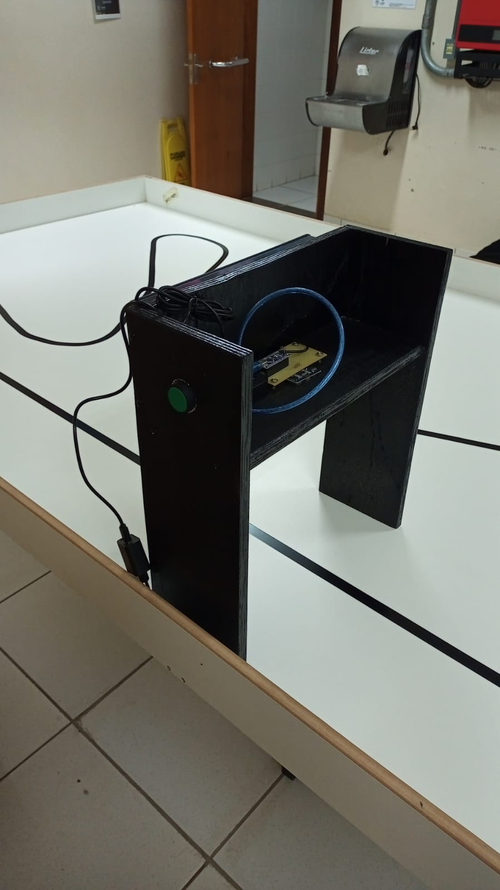
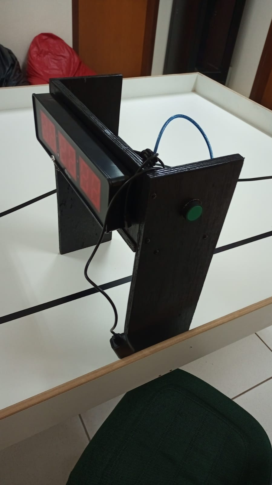

# Remote stopwatch control

An infrared (IR) control project for an LE2113 clock/timer used for lap time detection in line-following robot competitions, using different sensors.

The advantage of this code lies in already providing the necessary (pulse trains) commands to start and stop such timer via IR. Furthermore, flags and checks are employed to ensure smoother operation and facilitate the addition of new features.

The following programs are available:
- [IR ultrassonic sensor](./remote_stopwatch_ultrassonic_sensor)

## Physical experiment

The physical experiment is presented bellow

    
    

